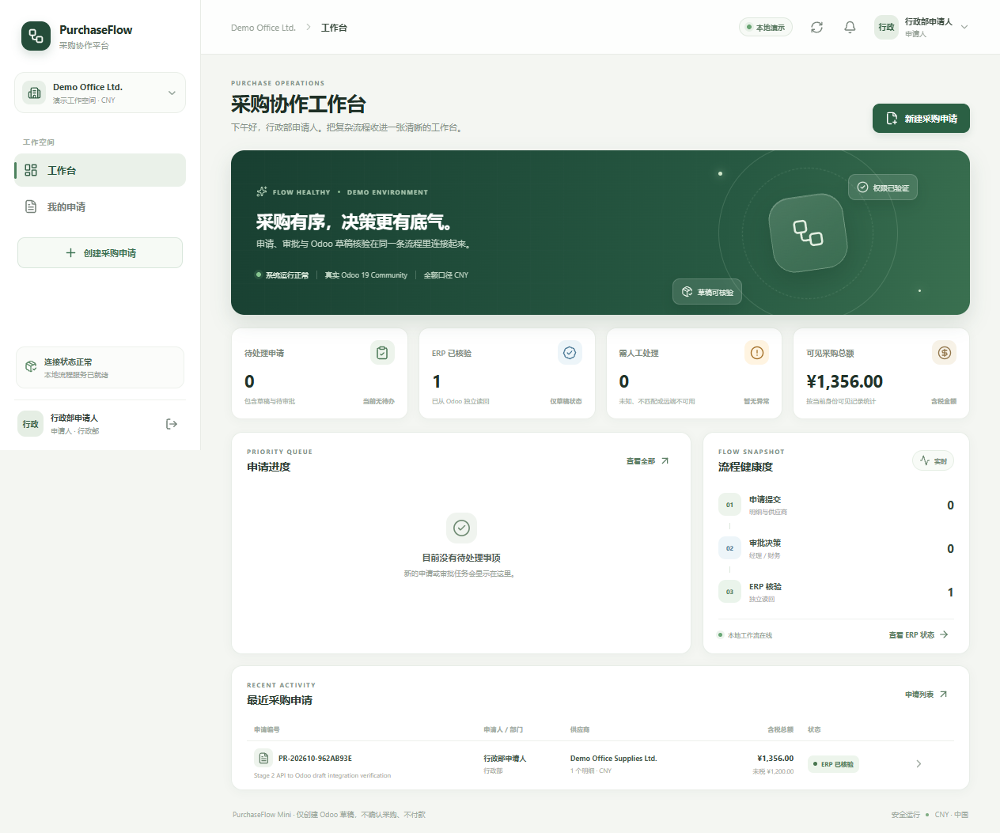

# PurchaseFlow

[English](README.en.md) | 简体中文

**面向中小企业的采购审批与 Odoo 19 草稿采购单集成演示。**

员工提交采购申请后，系统按部门和金额路由人工审批。获批后，后台工作进程只在真实 Odoo 中创建草稿采购单，并独立读回核对；只有核验通过的申请才能结案。

## 展示内容

- 申请人、部门负责人、财务、采购和管理员的分角色工作台。
- 使用 Decimal 计算人民币金额，按税前/含税政策判断审批层级，并冻结提交时的申请版本。
- 追加式审批与审计记录、幂等键、事务性 Outbox 和至少一次执行的后台 Worker。
- 稳定的外部意图标识，以及对真实 Odoo 19 Community 采购草稿的写后读回核验。
- 区分 ERP 结果未知、失败、不匹配和已核验；结果不明确时不盲目重复创建采购单。
- 两条 n8n 工作流：认证后的采购申请接入，以及工作日审批/ERP 摘要；邮件由本机 Mailpit 接收。
- Docker Compose、隔离的 PostgreSQL 数据库与角色、Alembic 迁移、单元和 PostgreSQL 并发测试，以及 Playwright 浏览器验收。

~~~mermaid
flowchart LR
  U[申请人 / 审批人] --> W[React + TypeScript 工作台]
  W --> A[FastAPI 业务流程与权限]
  A <--> D[(PurchaseFlow PostgreSQL)]
  A --> O[事务性 Outbox]
  O --> X[后台 Worker]
  X -->|JSON-2，稳定意图| E[Odoo 19 Community]
  X -->|独立读回| E
  N[n8n] -->|受限服务凭据| A
  N -->|仅内网 SMTP| M[Mailpit 邮箱]
~~~

本演示**不会确认采购单、收货、过账供应商账单或付款**。审批阈值和采购数据均为合成演示数据，不构成真实企业的财务规则建议。

## 本地启动

需要 Docker Desktop 与 Compose v2、PowerShell 7，以及首次下载镜像和依赖时的网络连接。

~~~powershell
pwsh ./scripts/start-demo.ps1
~~~

该命令会准备 Odoo 19 和本地凭据，创建相互隔离的应用与 n8n 数据库，构建 API 和前端镜像，执行 Alembic 迁移与幂等种子数据，导入加密保存的 n8n 凭据和工作流，并运行健康检查。

| 服务 | 本机地址 |
|---|---|
| PurchaseFlow | <http://127.0.0.1:18081> |
| FastAPI 文档 | <http://127.0.0.1:18000/docs> |
| Odoo 19 | <http://127.0.0.1:18069> |
| n8n 编辑器 | <http://127.0.0.1:18082> |
| Mailpit 收件箱 | <http://127.0.0.1:18025> |

登录页提供的是**明确选择演示身份**的入口，不是生产身份认证。选择一个合成角色即可查看对应工作流。n8n 使用生成的本地管理员账号（`automation-admin@demo.local`），密码保存在 Git 忽略的 `.local/n8n-owner-password`。Odoo 引导和管理员凭据也保存在 `.local/` 下的忽略文件中。

### n8n 工作流

- **认证采购申请接入**：`POST http://127.0.0.1:18082/webhook/purchaseflow/intake`。验证并通过仅供自动化角色使用的 API 提交幂等申请。
- **每日审批与 ERP 摘要**：每个工作日 Asia/Shanghai 09:00 运行，也可以调用 `POST http://127.0.0.1:18082/webhook/purchaseflow/summary`。工作流读取经过筛选的摘要 API，并将邮件发给合成的经理/财务地址；Mailpit 在本机接收，不向外部投递。

两个 Webhook 都要求 `Authorization: Bearer <本地自动化令牌>`。令牌保存在 `.local/automation-token.txt`；n8n 凭据从临时忽略文件导入，并使用持久化的 `.local/n8n.env` 加密密钥加密保存。工作流 JSON 不包含令牌或 SMTP 设置。运行 `scripts/verify-demo.ps1 -ExerciseN8nWorkflows` 会测试接入幂等性和本地摘要邮件，并创建一条合成待审批申请及一封 Mailpit 邮件。

## 验收与测试

~~~powershell
pwsh ./scripts/verify-demo.ps1
pwsh ./scripts/verify-demo.ps1 -ExerciseN8nWorkflows
pwsh ./scripts/bootstrap-test-db.ps1
docker compose -p purchaseflow-demo -f docker-compose.yml --profile test run --rm tests
~~~

首次 `verify-demo.ps1` 只读。可选的 n8n 工作流验收会创建一条合成申请和一封本地邮件。

浏览器验收使用 Node.js 24：

~~~powershell
cd frontend
npm ci
npx playwright install chromium
npm run build
npm run e2e
~~~

浏览器测试覆盖正常的 Odoo 交接、部门负责人和不同财务人员审批，以及申请人无法通过 API 自行审批。真实 Odoo 字段错配和 UNKNOWN 恢复需要先准备相应场景：

~~~powershell
pwsh ./scripts/run-erp-unknown-demo.ps1
pwsh ./scripts/run-erp-mismatch-demo.ps1 -Prepare
npm run e2e
pwsh ./scripts/run-erp-mismatch-demo.ps1 -Restore
~~~

UNKNOWN 脚本通过 API 创建合成申请，短暂停止本项目 Worker，在真实 Odoo 创建一张草稿后丢弃成功响应，再启动 Worker。采购身份通过相同稳定意图核验并可结案。错配脚本创建并核验真实 Odoo 草稿，再将订单行单价改动 CNY 1 元。PurchaseFlow 必须显示实际差异、把申请标记为 `erp_mismatch` 并拒绝结案；浏览器可查看差异并重新进行只读核验。最后脚本恢复原单价，并要求 PurchaseFlow 对同一张草稿重新读回为 `erp_verified`。控制脚本只修改本项目隔离演示环境中新建的合成草稿。

场景文件存在时，`npm run e2e` 会包含相应的浏览器恢复或错配测试。完成浏览器验收后，可运行 `pwsh ./scripts/verify-persistence.ps1`，它只重启本项目服务（不删卷），并复核申请、真实 Odoo 草稿、n8n 工作流和 Mailpit 邮件。

`scripts/seed-demo.ps1` 可在启动后重新执行幂等迁移和种子数据。`scripts/reset-demo.ps1` 只会在输入明确的确认语句后删除 PurchaseFlow 项目自己的卷；正常停止命令不会调用它。脚本会在要求确认前列出确认短语和受影响的卷。

GitHub Actions 会运行 Python 静态检查与类型检查、Python 和 npm 依赖审计、隔离 PostgreSQL 并发测试、Docker/Odoo/n8n/Mailpit 启动验收、静态 n8n 合同检查和浏览器测试。手动运行的 [`controlled-purchaseflow-integration`](.github/workflows/controlled-purchaseflow-integration.yml) 还会验证真实 Odoo 响应丢失、UNKNOWN 恢复、字段错配、拒绝错配结案、浏览器展示差异、恢复并重新核验，以及服务重启后的持久性。`main` 要求通过 Pull Request 合并，且必须通过 `PurchaseFlow CI` 的 `acceptance` 检查。

## 安全停止

~~~powershell
pwsh ./scripts/stop-demo.ps1
~~~

该命令停止容器，**保留** PostgreSQL、Odoo filestore、n8n 和 Mailpit 数据卷。再次启动不会删除数据，并会重新执行幂等种子步骤。本地凭据保存在 Git 忽略的 `.local/`。请保留 `.local/n8n.env` 与具名 n8n 数据卷的对应关系；缺少加密密钥时，n8n 无法解密已保存的凭据。所有服务端口只绑定回环地址 `127.0.0.1`，不会绑定到局域网。

## 架构与证据

[含中文字幕的 4 分半产品演示](docs/RECORDING.md)

- [系统架构](docs/ARCHITECTURE.zh-CN.md)
- [业务规则](docs/BUSINESS-RULES.md)
- [工作流权限与失败状态](docs/WORKFLOW-AUTHORITY.md)
- [数据合同](docs/DATA-CONTRACTS.md)
- [Odoo 集成与安全边界](docs/ODOO-INTEGRATION.md)
- [本地运行手册](docs/RUNBOOK.zh-CN.md)
- [安全边界](docs/SECURITY.zh-CN.md)
- [测试证据与限制](docs/TEST-EVIDENCE.md)
- [求职作品说明](docs/PORTFOLIO.zh-CN.md)
- [面试讲解稿](docs/INTERVIEW-PITCH.md)
- [录屏与字幕](docs/RECORDING.md)
- [Feishu 适配器状态与租户接入](docs/FEISHU.zh-CN.md)
- [版本化 n8n 工作流](n8n/workflows/README.zh-CN.md)

Feishu 是一个可选扩展，目前未连接真实租户；本项目不声称已有在线 Feishu 集成。
