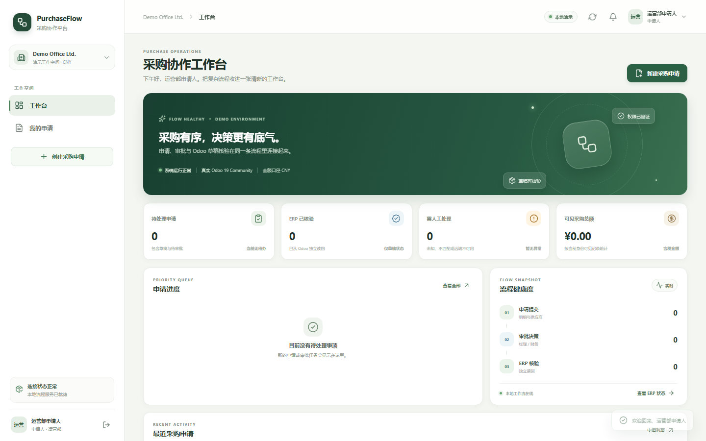
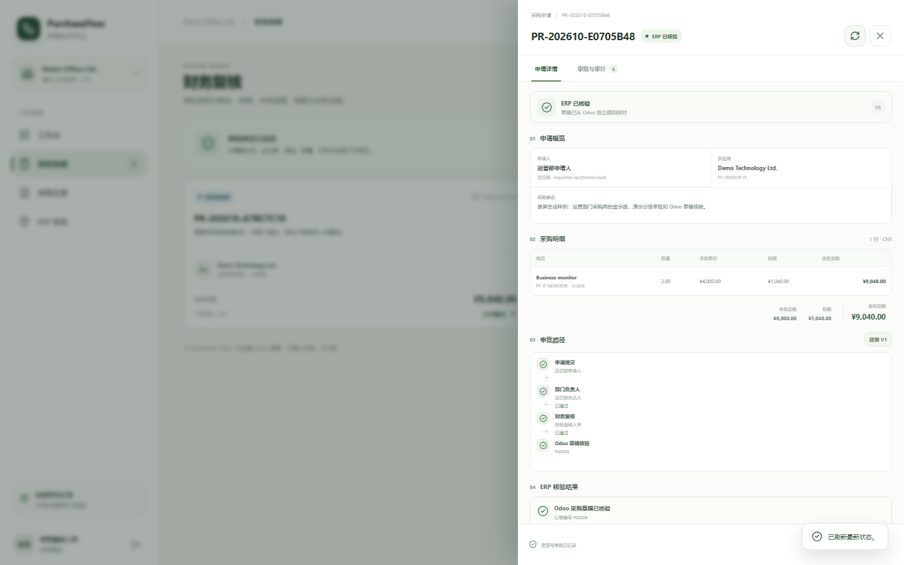
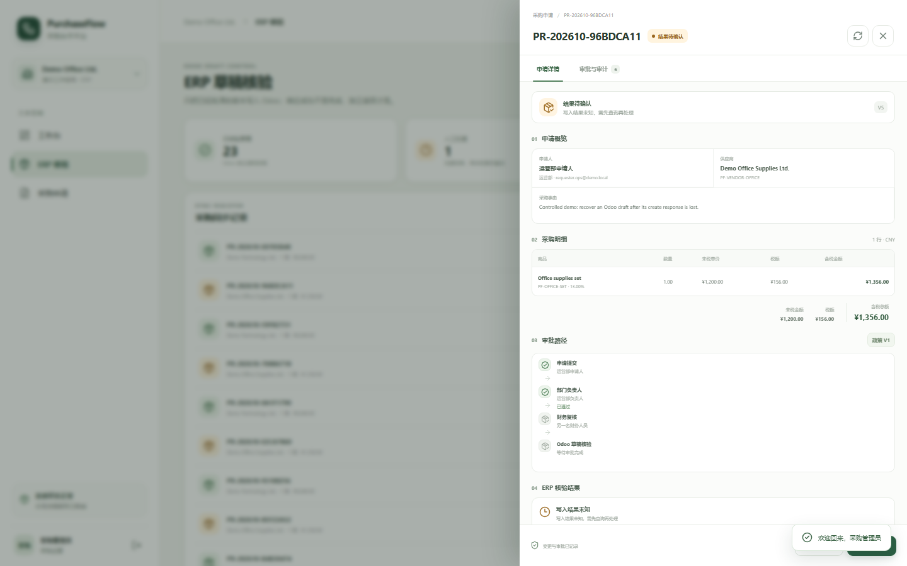
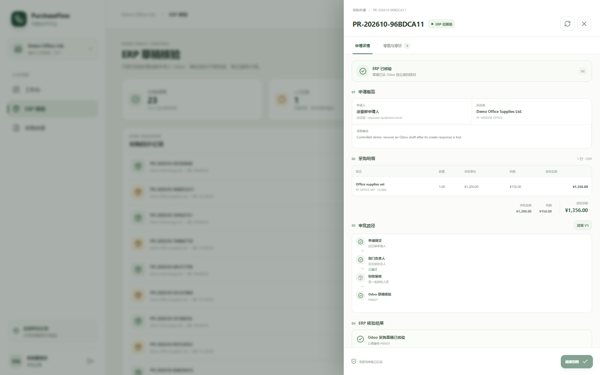
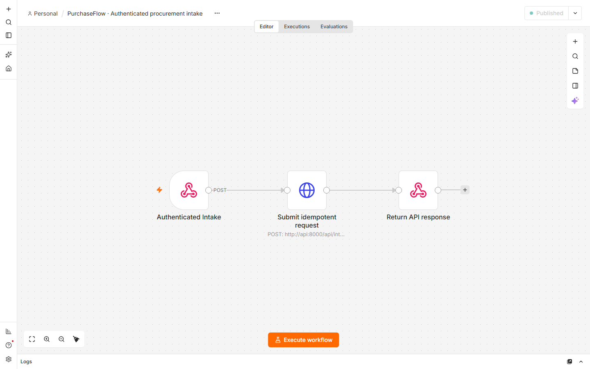
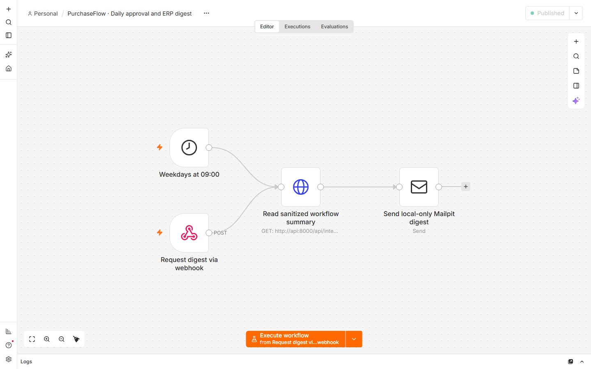
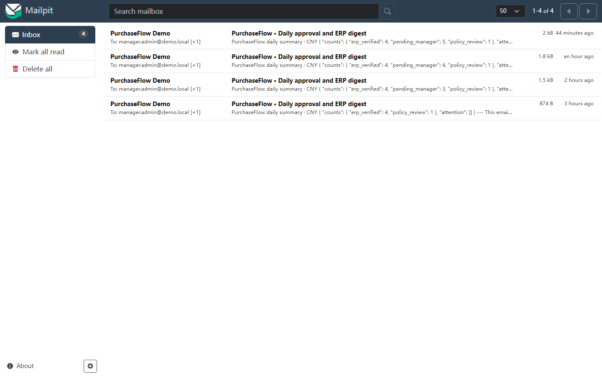

# Portfolio narrative

## The problem

Small teams often collect purchases in chats and spreadsheets. Requests, manager decisions, finance review, supplier/product mapping, and ERP entry become separate handoffs, so a requester cannot easily tell what is waiting or whether the ERP received an approved purchase. A naïve integration can create a duplicate PO when Odoo commits but the response is lost.

## Product decision

PurchaseFlow treats the ERP boundary as a reliability and authority problem, not a form-submission problem:

1. The requester submits a validated request and sees the versioned demo policy used.
2. Distinct approvers make recorded decisions; the second finance reviewer cannot be the requester or manager.
3. Approval commits a frozen snapshot, stable ERP intent, and outbox event atomically.
4. A worker writes only a draft, then reads it back independently.
5. An ambiguous outcome becomes erp_unknown; recovery searches by the same stable intent and does not blindly create another draft.
6. A real Odoo unique constraint on the intent ID provides a second line of duplicate protection.

## Stack and boundaries

React/TypeScript provides the role-aware workbench. FastAPI owns workflow transitions and authorization. Postgres stores versioned workflow/audit data and the outbox. A background worker integrates with real Odoo 19 Community over JSON-2. n8n uses a separate automation role and encrypted credentials for authenticated intake and notifications. Mailpit captures the digest locally.

The whole stack runs in Docker Compose with loopback-only host ports, separate Postgres databases/roles, synthetic CNY data, and one-click start/verify/stop scripts.

## The two n8n workflows

- **Procurement intake:** accepts an authenticated external request event, maps its requester/department/vendor/product fields, and submits it through the automation-only API with the event ID as an idempotency key. Replaying identical content returns the same request; reusing the event ID with changed content is rejected.
- **Daily approval and ERP digest:** runs on weekday mornings or by an authenticated manual webhook, reads a sanitized summary from the API, and emails synthetic manager/finance addresses into Mailpit. It does not read the database or create/approve ERP orders.

## Human decisions and uncertain outcomes

Department managers approve or reject requests. Above the demo threshold, a different finance user must approve before an ERP intent exists. Amounts above the policy-review ceiling stop for an explicitly recorded administrator exception, after which the regular manager and finance steps still apply. PurchaseFlow writes only an Odoo draft after the required decisions.

If a create response is lost, the application records `erp_unknown` and stops automatic creation. A procurement user checks Odoo by the same intent ID, reviews the real returned facts, and only retries that intent after a read confirms the order is absent. The controlled response-loss scenario uses a real Odoo record and is covered by `scripts/run-erp-unknown-demo.ps1` plus the browser recovery test.

## Evidence

- Real Odoo 19 Community JSON-2 create, independent read-back, duplicate-intent guard, and persistence check: [test evidence](TEST-EVIDENCE.en.md).
- Python unit and Postgres concurrency tests: tests/.
- Browser acceptance: requester -> manager -> Odoo draft verification, distinct finance review, and UNKNOWN recovery: [frontend/tests](../frontend/tests/).
- n8n authenticated intake/replay and local Mailpit digest: scripts/verify-demo.ps1 -ExerciseN8nWorkflows.
- [PurchaseFlow workbench](assets/purchaseflow-overview.png), [submitted request](assets/purchaseflow-submitted-request.png), [real Odoo draft read-back](assets/purchaseflow-odoo-verified.png), [UNKNOWN before reconciliation](assets/purchaseflow-unknown-before-reconcile.png), [recovered UNKNOWN request](assets/purchaseflow-unknown-recovered.png), [n8n intake](assets/n8n-procurement-intake.png), [n8n daily digest](assets/n8n-daily-digest.png), and [Mailpit digest](assets/purchaseflow-mailpit-digest.png).
- Recorded walkthrough and Chinese subtitles: [recording](assets/purchaseflow-demo.mp4), [SRT subtitles](assets/purchaseflow-demo.zh-CN.srt), [recording outline](RECORDING.en.md).
- Short interview explanation: [INTERVIEW-PITCH.en.md](INTERVIEW-PITCH.en.md).

## Screenshots

### Role-aware workbench

### Real Odoo draft verified from the application

### Ambiguous create result before and after human reconciliation

### Operational automation and local email delivery

## Scope honesty

This is a local demonstration, not a production procurement product. The role picker is demo-only. Approval thresholds are illustrative. The scope stops at an Odoo draft; no PO confirmation, receipt, bill posting, payment, or live email delivery occurs.

The Feishu connector is an optional future extension. This repository does not claim a live Feishu tenant connection because no authorized tenant credentials were available.
